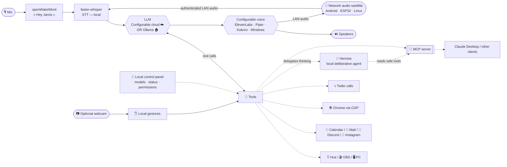

# Jarvis — full feature list

*Summary and install: [README](../README.en.md).*

**🧠 Jarvis + Hermes.** Jarvis delegates long-form research and planning to the
local [Hermes](hermes.md) agent. The boundary is explicit: **Hermes orchestrates
and thinks; Jarvis holds the keys and the body**. Jarvis alone performs actions, and
credentials never enter the Hermes environment.

**📡 Jarvis in every room.** Add one or more **network audio satellites** to move
the microphone and speaker into a kitchen, living room, or any other room. The PC
remains the central brain, with no long cable back to it. The available client
currently targets Raspberry Pi/Linux, while the protocol is designed to support
cheaper endpoints later: a reused Android phone, an audio-capable ESP32, or a Pi
Zero ([options and protocol](satellite.md) ·
[hardware choice and installation](satellite_installation.md) ·
[detailed Raspberry/Linux setup](satellite_pi.md)).

> Personal project shared as-is. Targets **Windows 11**, needs a microphone and (for
> cloud mode) an API key from the selected provider. Consumer subscriptions and APIs
> are generally separate. Most integrations are **optional** and disable
> themselves cleanly when unconfigured.

## ✨ Features

- 🎙️ **Voice-first** — wake word (openWakeWord), local transcription (Whisper), spoken replies
- 👁️ **Screen vision** — "what's this error?", "read this", "translate that" (screenshot → LLM)
- 💡 **Smart home** — Philips Hue (on/off, brightness, color), light scenes & moods
- 🎬 **Streaming** — OBS control (stream, record, scenes, replay buffer)
- 🖥️ **PC control** — launch apps, media/volume, live GPU/CPU/RAM stats
- 📅 **Calendar** — Google Calendar across **all** your calendars (incl. subscribed iCal), create/delete with confirmation
- 📧 **Email** — Gmail summaries and drafting
- 💬 **Discord** — mentions + daily channel digest
- 📸 **Instagram** — followers & video views vs. yesterday (multi-account)
- 🍽️ **Web reservations** — books restaurants/appointments via a real browser (Playwright)
- 🌐 **Browser assistant** — summarize/translate the active tab, manage tabs, act on pages (your real Chrome)
- 📞 **Phone calls** — Twilio: play a message, or a real-time conversation (make a reservation by phone)
- 🧠 **Long-term memory** — remembers your preferences, people, projects
- 📱 **iPhone bridge** — send ideas/notes and commands from the Shortcuts app (Siri as a remote control)
- 🎭 **Personalities** — sarcastic butler, neutral, concise — switch by voice
- 🏠 **Presence** — pings your phone, triggers scenes when you leave/return
- 🚀 **Automatic startup & scenes** — starts Jarvis and its local chain at sign-in, runs a first-start daily weather/calendar brief, and prepares a clean shutdown
- 🌤️ **Utilities** — weather, timers, time/date
- 🔌 **MCP server** — exposes home/PC tools to any MCP client (Claude Desktop, Hermes…)
- 🎬 **Content hub** — local inspiration vault, transcription/indexing, ideas and scripts, plus YouTube ingestion ([docs/hub_contenu.md](hub_contenu.md))
- 🗂️ **Content tracking** — video workflow from idea to published, linked to calendar deadlines ([docs/suivi_contenu.md](suivi_contenu.md))
- 🤝 **Hermes delegation** — delegates long-form thinking and research to a sandboxed local agent ([docs/hermes.md](hermes.md))
- 🧭 **Local HUD & control panel** (`/panneau`) — quick model/voice controls, chain status, settings and permissions; local access only ([docs/panneau.md](panneau.md))
- 🔐 **Graduated safety** — N1/N2/N3 permission levels, revocable remembered approvals, and hard confirmation boundaries for critical actions
- 💸 **Routing & budgets** — three modes (local/hybrid/quality), independently configurable cloud provider and voice, cost tracking, alerts, and automatic local fallback at the spending cap ([docs/costs.md](costs.md))
- 📊 **Private local cockpit** — subscriptions, upcoming charges, Gmail receipt detection, and CSV transaction import; financial data remains gitignored and unavailable to Hermes/MCP ([docs/cockpit.md](cockpit.md))
- ⏻ **Safe PC shutdown / wake-up** — voice-confirmed N3 shutdown with a cancellable delay; hardware-dependent wake methods are documented generically ([docs/wol.md](wol.md))
- ✋ **Optional camera and hand-gesture control** — when a webcam is configured, **Window** (switch/scroll) and **Audio** (volume/tracks) modes complement light/media/OBS actions; processing stays 100% local and no image leaves the tracker ([docs/gestes.md](gestes.md))
- 📡 **Multi-room satellites** — move the microphone and speaker to a network client; Raspberry/Linux is available, Pi Zero 2 W is experimental, and Android/audio-capable ESP32 clients still need to be developed. Local wake word, authenticated LAN audio, room context, and spoken confirmations for sensitive actions ([installation and hardware status](satellite_installation.md) · [protocol](satellite.md))
- 🎵 **Music recognition** — identify room audio or a video's system audio on demand ([docs/musique.md](musique.md))
- 🪟 **Response overlay** — a no-focus-steal floating text window, configurable display, OBS-safe capture behavior, and visual silent mode ([docs/overlay.md](overlay.md))
- 🏠 **Google Home / Nest** — *(experimental)* device listing and status ([docs/google_home.md](google_home.md))
- 🔵 **Alexa / Echo** — announcements, media, and device control through routines via an unofficial API ([docs/alexa.md](alexa.md))

## 🏗️ Architecture

## 🗺️ Roadmap

- [x] Hermes delegation, local content hub, and content tracking
- [x] Local control panel with model/status/permission controls and LLM budgets
- [x] Automatic startup, daily brief, and clean shutdown scenes
- [x] Camera hand gestures v2 with Window and Audio modes
- [x] Private local cockpit phase 1 (subscriptions, receipt detection, CSV transactions)
- [x] Raspberry Pi/Linux satellite client (audio, wake word, authenticated LAN protocol, multi-room); each installation can choose its own audio hardware
- [ ] Low-cost satellite clients for reused Android phones and audio-capable ESP32 boards, using the same protocol while the PC remains the central brain
- [ ] Optional low-cost cloud connectors for the Gemini free tier and DeepSeek, with tested tool calls, cost tracking, and local fallback when quotas are exhausted
- [ ] Godox video-light control (currently Hue only)
- [x] Notes / ideas (+ iPhone bridge via Shortcuts) — scheduled reminders next
- [ ] Sentence-by-sentence streaming TTS (see [docs/latency.md](latency.md))
- [ ] 100% local browser loop: `qwen3.5` vision already reads button text (tested) — full page-driving still to validate
- [ ] Automatic Instagram token refresh across restarts (partial today)
