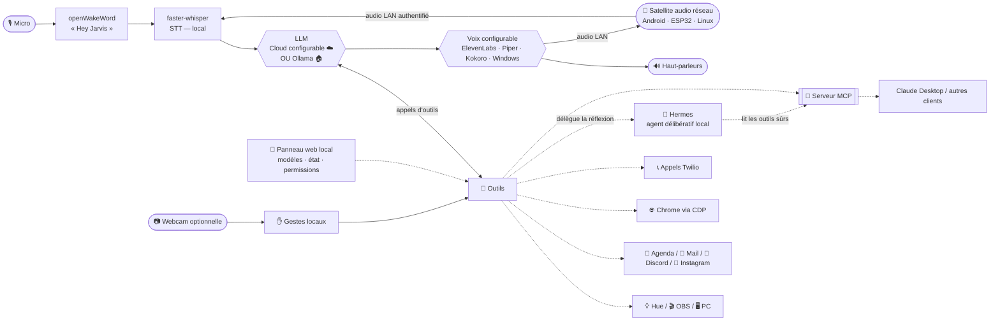

# Jarvis — toutes les fonctionnalités

*Résumé et installation : [README](../README.md).*

**🧠 Jarvis + Hermes.** Pour la réflexion de fond et la recherche, Jarvis **délègue à
[Hermes](hermes.md)**, un agent délibératif qui tourne **en local** (conteneur
Docker, recommandé dans une VM Ubuntu isolée). La doctrine est nette : **Hermes orchestre et pense ; Jarvis détient les clés
et le corps** — c'est toujours Jarvis qui exécute les actions, jamais Hermes, et
**aucun identifiant ne vit dans l'environnement d'Hermes** (il lit le Vault et les
outils sûrs, écrit seulement des brouillons).

**📡 Jarvis dans chaque pièce.** Ajoute un ou plusieurs **satellites audio réseau**
pour déporter le micro et le haut-parleur dans la cuisine, le salon ou une autre
pièce. Le PC reste le cerveau central ; aucun long câble ne le relie aux pièces.
Le client disponible aujourd'hui cible Raspberry Pi/Linux, mais le protocole est
prévu pour accueillir des solutions moins chères : ancien téléphone Android,
ESP32 avec audio ou Pi Zero ([options et fonctionnement](satellite.md) ·
[guide de choix et d'installation](satellite_installation.md) ·
[installation Raspberry/Linux détaillée](satellite_pi.md)).

**🖥️ Serveur sans écran + poste principal.** Jarvis peut tourner 24 h/24 sur un
ancien PC sans écran, tandis qu'un agent Windows authentifié déporte le micro, le
son, les applications, Chrome, OBS, la webcam, les gestes et le contrôle Astra vers
le PC utilisé au quotidien ([guide complet](poste_principal_windows.md)).

> **Pas de deuxième ordinateur ?** Un seul PC reste la solution la plus simple.
> Pour du H24, le cerveau peut aussi être placé sur un NAS, un mini-PC ou un VPS,
> avec les limites de chaque option dans le
> [comparatif des hébergements H24](hebergement_h24.md).

> Projet perso partagé tel quel. Cible **Windows 11**, nécessite un micro et (en mode
> cloud) une clé API du fournisseur choisi. Les abonnements grand public et les API
> sont généralement séparés. La plupart des intégrations sont **optionnelles** et se
> désactivent proprement si non configurées.

## ✨ Fonctionnalités

- 🎙️ **Tout à la voix** — mot d'activation (openWakeWord), transcription locale (Whisper), réponses parlées
- 👁️ **Vision de l'écran** — « c'est quoi cette erreur ? », « lis ça », « traduis » (capture → LLM)
- 💡 **Domotique** — Philips Hue (allumer, luminosité, couleur), ambiances/scènes
- 🎬 **Streaming** — contrôle d'OBS (direct, enregistrement, scènes, replay)
- 🖥️ **Contrôle PC** — lancer des apps, média/volume, stats GPU/CPU/RAM en direct
- 🧩 **Corps Windows déporté** — ancien PC serveur sans écran, nouveau PC principal pour l'audio, l'écran, Astra, Chrome, OBS et les gestes ([installation](poste_principal_windows.md))
- 📅 **Agenda** — Google Agenda sur **tous** tes agendas (y compris abonnés iCal), création/suppression avec confirmation
- 📧 **Mail** — résumés Gmail et rédaction
- 💬 **Discord** — mentions + récap des messages du jour
- 📸 **Instagram** — abonnés & vues des vidéos vs la veille (multi-comptes)
- 🍽️ **Réservations web** — réserve resto/rendez-vous via un vrai navigateur (Playwright)
- 🌐 **Assistant navigateur** — résume/traduit l'onglet actif, gère les onglets, agit sur les pages (ton vrai Chrome)
- 📞 **Appels téléphoniques** — Twilio : jouer un message, ou une vraie conversation temps réel
- 🧠 **Mémoire long terme** — retient tes préférences, tes proches, tes projets
- 📱 **Pont iPhone** — envoie idées/notes et commandes depuis l'app Raccourcis (Siri comme télécommande à distance)
- 🎭 **Personnalités** — majordome sarcastique, neutre, concis — changeable à la voix
- 🏠 **Présence** — ping ton téléphone, déclenche des scènes quand tu pars/reviens
- 🚀 **Démarrage & scènes automatiques** — lance Jarvis et sa chaîne locale à l'ouverture de session, joue un brief météo/agenda au premier démarrage de la journée et prépare une extinction propre
- 🌤️ **Utilitaires** — météo, minuteurs, heure/date
- 🔌 **Serveur MCP** — expose les outils domotique/PC à tout client MCP (Claude Desktop, Hermes…)
- 🎬 **Hub de contenu** — vault d'inspirations Insta/TikTok (télécharge, transcrit, indexe), idées & scripts générés, ingestion YouTube ([docs/hub_contenu.md](hub_contenu.md))
- 🗂️ **Suivi de contenus** — pipeline vidéo *idée → script → tournage → montage → publié*, croisé avec ton agenda ; « où j'en suis ? » ([docs/suivi_contenu.md](suivi_contenu.md))
- 🤝 **Délégation à Hermes** — confie la réflexion / recherche de fond à un agent délibératif **local** (doctrine : Jarvis tient les clés & le corps, Hermes pense) ([fonctionnement](hermes.md) · [serveur Ubuntu/Hyper-V](hermes_server_vm.md))
- 🧭 **HUD & panneau web local** (`/panneau`) — commandes rapides de modèle/voix, état de la chaîne, réglages et permissions — **accessibles en local uniquement** ([docs/panneau.md](panneau.md))
- 🔐 **Sécurité graduée** — niveaux **N1/N2/N3** par outil, « toujours autoriser » révocable, budget LLM par fournisseur
- 💸 **Routage & budgets** — 3 modes (local / hybride / qualité), fournisseur cloud et voix configurables séparément, suivi des coûts et **bascule auto en local** au plafond ([docs/costs.md](costs.md))
- 📊 **Cockpit personnel local** — abonnements, échéances, détection par reçus Gmail et import CSV de transactions ; les données financières restent gitignorées et ne sont jamais exposées à Hermes/MCP ([docs/cockpit.md](cockpit.md))
- ⏻ **Extinction / réveil du PC** — extinction propre à la voix (confirmation N3, délai annulable) ; méthodes génériques de réveil documentées selon le matériel ([docs/wol.md](wol.md))
- ✋ **Contrôle optionnel par caméra et gestes** — avec une webcam configurée, les modes **Fenêtres** (changer/défiler) et **Audio** (volume/pistes) complètent les actions lumière/média/OBS ; traitement **100 % local**, aucune image ne sort ([docs/gestes.md](gestes.md))
- 📡 **Satellites multi-pièces** — déporte micro et haut-parleur sur un client réseau ; Raspberry/Linux est disponible, le Pi Zero 2 W est expérimental, et Android/ESP32 audio restent des cibles à développer. Wake word local, LAN authentifié, contexte de la pièce et confirmations vocales sensibles ([installation et choix du matériel](satellite_installation.md) · [protocole](satellite.md))
- 🗞️ **Signal Matin** — compose un quotidien personnel A4 monochrome à partir d’un JSON validé : briefing, actualités sourcées, agenda, priorités et veille. Preview HTML, PDF Playwright, densité adaptative et deux automatismes d'impression au choix : heure fixe sur une machine disponible 24 h/24, ou premier brief quotidien au démarrage du PC, sans doublon lors des relances ([guide](signal_matin.md) · [design system](signal_matin_design.md))
- 🎵 **Reconnaissance musicale** — « c'est quoi cette musique ? » (micro de la pièce **ou** son d'une vidéo/reel via loopback), à la demande uniquement ([docs/musique.md](musique.md))
- 🪟 **Overlay de réponses** — mini-fenêtre flottante qui affiche à l'écrit ce que Jarvis dit, sans jamais voler le focus (topmost, clic-transparent, invisible en stream), 2e écran configurable + mode silencieux visuel ([docs/overlay.md](overlay.md))
- 🏠 **Google Home / Nest** — *(⚠️ expérimental)* liste des appareils Nest + état ([docs/google_home.md](google_home.md))
- 🔵 **Alexa / Echo** — *(via API non officielle)* annonces/TTS, média, et contrôle d'appareils via Routines (« allume la clim », « éteins la télé ») ([docs/alexa.md](alexa.md))

## 🏗️ Architecture

> **Jarvis tient les clés & le corps** (il exécute) ; **Hermes pense** (réflexion, recherche,
> analyse du Vault). Hermes ne voit que les **outils sûrs** exposés par le serveur MCP de Jarvis.

## 🗺️ Roadmap

- [x] **Délégation à Hermes** (agent délibératif local) + gateway Telegram (whitelist stricte)
- [x] **Hub de contenu** : Vault d'inspirations + génération d'idées/scripts + ingestion YouTube
- [x] **Suivi de contenus** : pipeline idée → publié, croisé avec l'agenda
- [x] **Panneau web local** : modèles · état de la chaîne · permissions **N1/N2/N3** · budget LLM
- [x] **Démarrage automatique & scènes** : chaîne Jarvis/Hermes, brief quotidien météo/agenda et scène d'extinction
- [x] **Extinction propre du PC** (N3, délai annulable) — options de réveil documentées séparément selon le matériel
- [x] **Contrôle caméra/gestes v2** : modes Fenêtres et Audio, calibration locale et garde-fous anti-faux-positifs
- [x] **Cockpit local — phase 1** : abonnements, détection par mail et transactions CSV
- [x] **Client satellite Raspberry Pi/Linux** : audio, wake word, protocole LAN sécurisé et multi-pièces — matériel audio choisi librement par chaque installation
- [ ] **Clients satellites économiques** : ancien téléphone Android et ESP32 audio, sur le même protocole sans déplacer le cerveau hors du PC
- [ ] **Connecteurs cloud économiques optionnels** : Gemini (niveau gratuit) et DeepSeek, avec appels d'outils testés, suivi des coûts et repli local sur quota épuisé
- [ ] Contrôle des lampes vidéo Godox (aujourd'hui Hue seulement)
- [x] Notes / idées (+ pont iPhone via Raccourcis) — rappels programmés à venir
- [ ] Adaptateur générique de réveil/alimentation avec vérification d'état robuste
- [ ] TTS en streaming phrase par phrase (voir [docs/latency.md](latency.md))
- [ ] Boucle navigateur en 100 % local : la vision de `qwen3.5` lit déjà le texte des boutons (testé) — reste à valider le pilotage complet
- [ ] Rafraîchissement auto des tokens Instagram entre redémarrages (partiel aujourd'hui)
